# Customer Segmentation – RFM + Clustering (Online Retail II)

Unsupervised segmentation of an online retailer's customers using **RFM features** (Recency, Frequency, Monetary)
and three clustering algorithms: **K-Means**, **Agglomerative Hierarchical Clustering (Ward)** and **DBSCAN**.

> **Business question:** *What types of customers does the store have, and which commercial action fits each one?*
>
> **Unsupervised challenge:** without labels, the key task is to **validate** that the segments are real and useful,
> not an artifact of the algorithm.

---

## Key results

The store's **5,832 customers** fall into **four behavioral segments**:

| Segment | % customers | % revenue | Profile (medians) | Recommended action |
|---|---|---|---|---|
| 🏆 **Champions** | 19.0% | **71.8%** | 15 days · 13 orders · £5,032 | Retain & reward (loyalty program, account management) |
| ⚠️ **At Risk** | 25.3% | 18.1% | 158 days · 5 orders · £1,530 | Win back (personalized reactivation) |
| 🌱 **New/Promising** | 20.9% | 6.1% | 23 days · 3 orders · £702 | Nurture & increase purchase frequency |
| 💤 **Lost** | 34.8% | 4.1% | 400 days · 1 order · £281 | Low-cost mass campaigns only |

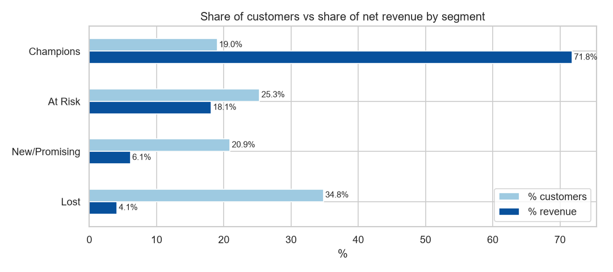

**Main insights**
- **Strong Pareto effect:** 19% of customers generate ~72% of net revenue. One Champion is worth ~32 Lost customers
  (£10,606 vs £331 revenue per customer).
- **Value is driven by frequency, not basket size:** average order value varies only 1.8× across segments (£201–£358),
  while total spend varies 18× (£281–£5,032).
- **Early-warning list:** border analysis found 24 *At Risk* customers with a near-Champion profile (9 orders, median £4,350)
  who stopped buying only ~40 days ago: the highest-priority retention targets.
- **Clustering adds value over rule-based RFM:** it simplifies 10 rule-based segments into 4, and detects that over half
  of the rule-based "Loyal Customers" are already cooling down.

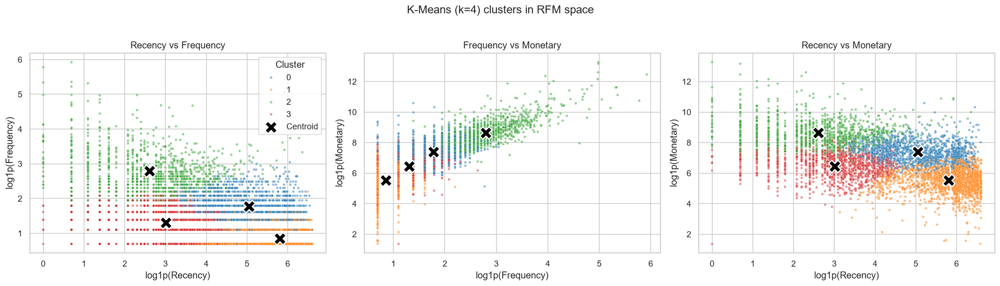

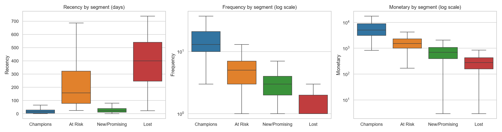

---

## Dataset

[Online Retail II – UCI Machine Learning Repository](https://archive.ics.uci.edu/dataset/502/online+retail+ii):
~1.07M transactions of a UK-based online gift retailer (Dec 2009 – Dec 2011). Many customers are wholesalers.

| Cleaning step | Rows remaining |
|---|---|
| Raw data (2 sheets combined) | 1,067,371 |
| Drop missing Customer ID (22.8%) | 824,364 |
| Drop cancellations, Quantity/Price ≤ 0, non-product codes, duplicates | 776,577 |

**Cleaning assumptions**
- **Non-product StockCodes** (postage, fees, manual adjustments) are removed: per UCI, a product code is a 5-digit number.
- **Cancellations are netted out of Monetary** instead of simply dropped. Dropping them alone would keep cancelled orders as sales:
  e.g., customer 12346 placed and cancelled a £77k order; their Monetary drops from £77,352 to £169 after netting.

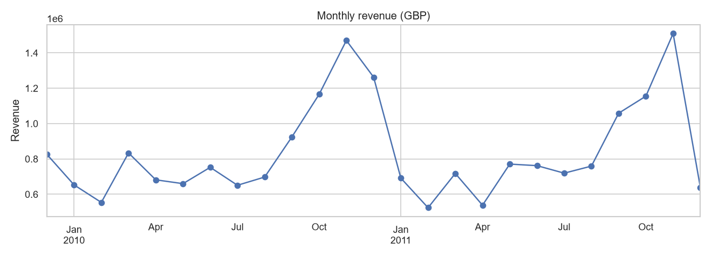

---

## Methodology

1. **EDA**: data quality, non-product codes, countries (91% UK), strong Oct–Nov seasonality.
2. **RFM features** per customer, **log1p transform** (Frequency and Monetary skewness of 12 and 27) and **standard scaling**.
3. **Baseline**: classic rule-based RFM segmentation (quintile scores + standard segment map).
4. **Choosing k**: dendrogram (Ward) gap analysis, elbow method and silhouette → **k = 4** (silhouette local peak).
5. **Models**: K-Means (Lloyd, k-means++, 20 restarts) and Hierarchical (Ward) with k = 4 and k = 6.
6. **DBSCAN**: eps from the k-distance plot, sensitivity analysis over eps and min_samples.
7. **Validation** (see below).
8. **Interpretation**: segment profiles, business actions and border customers (per-customer silhouette).

### Feature engineering

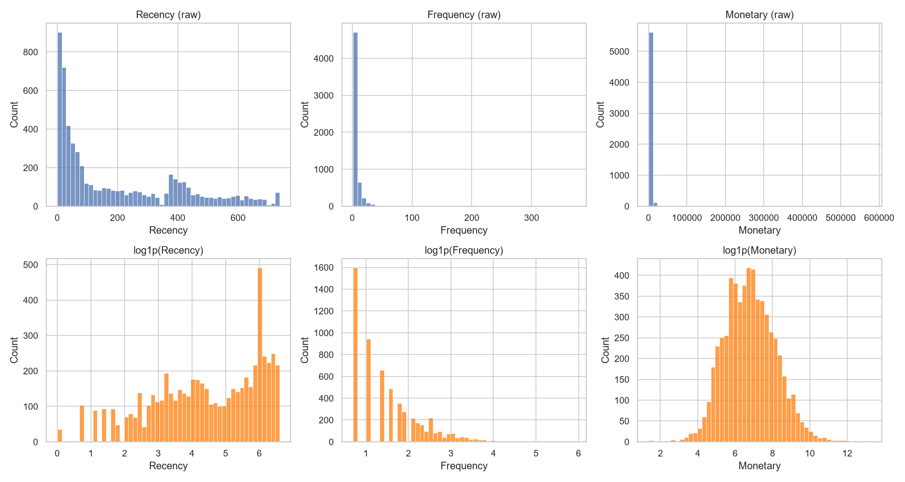

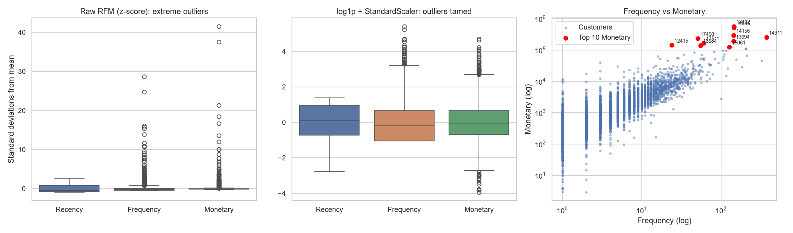

### Baseline: rule-based RFM

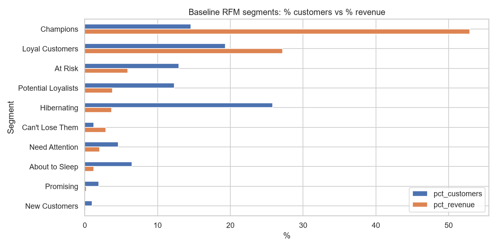

### Choosing k

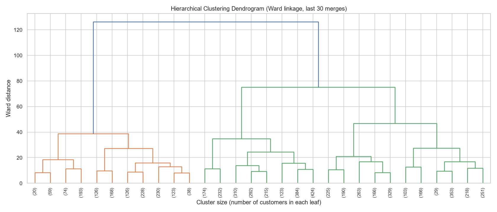

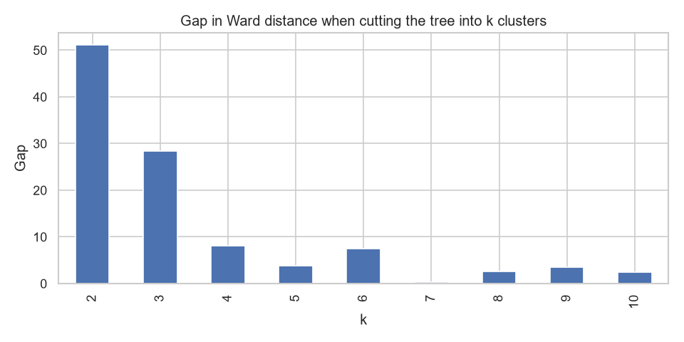

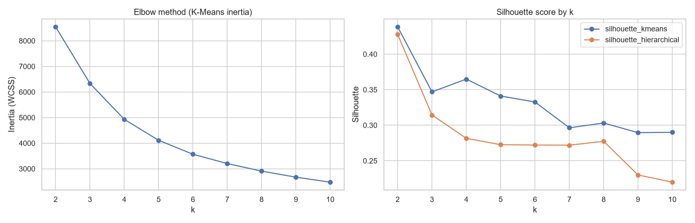

### DBSCAN

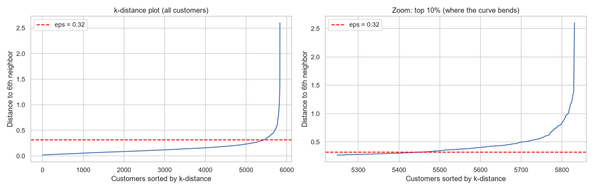

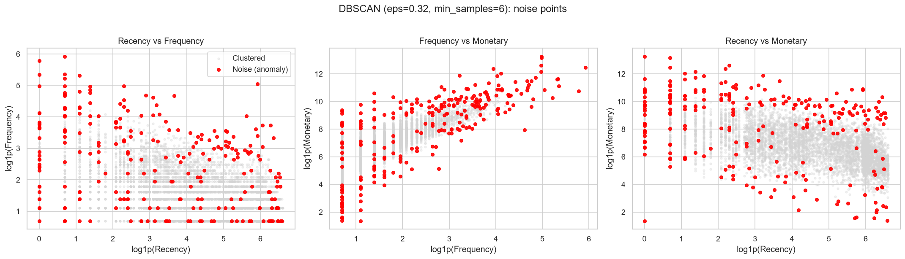

---

## Validation: are the segments real?

| Test | Result |
|---|---|
| **Internal metrics** (K-Means k=4) | Silhouette 0.36 · Davies-Bouldin 0.94 · Calinski-Harabasz 4,952. Best of all models tested (vs Hierarchical and k=6) |
| **Agreement between algorithms** | K-Means and Ward recover the same 4 archetypes (ARI = 0.59); Champions 99% and Lost 93% agreement |
| **Stability** (50 subsamples of 80%) | Mean ARI 0.95 (k=4) vs 0.89 (k=6); per-segment Jaccard ≥ 0.94 → *highly stable* (Hennig, 2007) |
| **vs rule-based RFM** | ARI = 0.44: related but not identical; clustering refines the rules |
| **DBSCAN** | No density-separated groups under any parameter setting → customer behavior is a **continuum** |

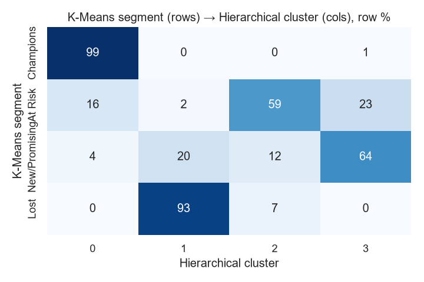

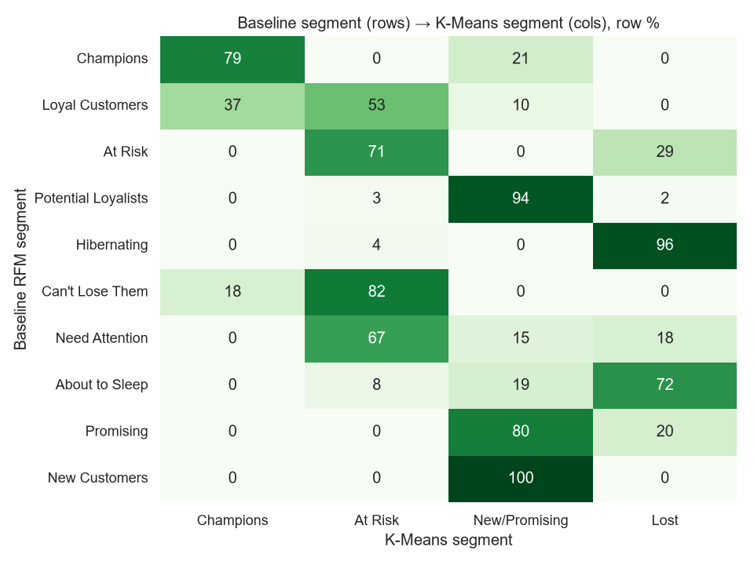

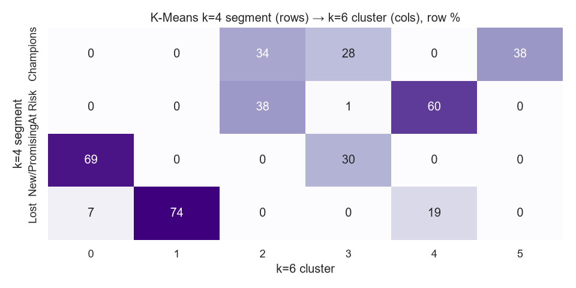

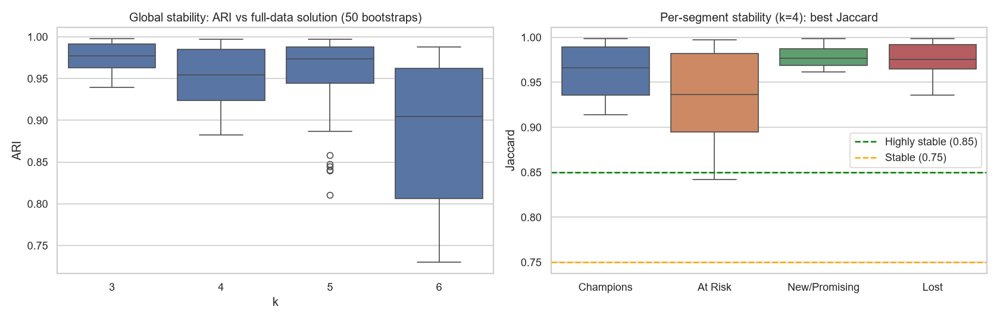

**Honest reading:** a silhouette of 0.36 indicates a *weak-to-moderate* structure. RFM behavior is a continuum, so the
segments are useful **partitions** of it rather than natural islands. Their validity rests on agreement between algorithms,
stability and business interpretability, not on internal metrics alone.

**Weak spot:** *At Risk* is the least crisp segment. It sits at the center of the continuum and borders the other three.

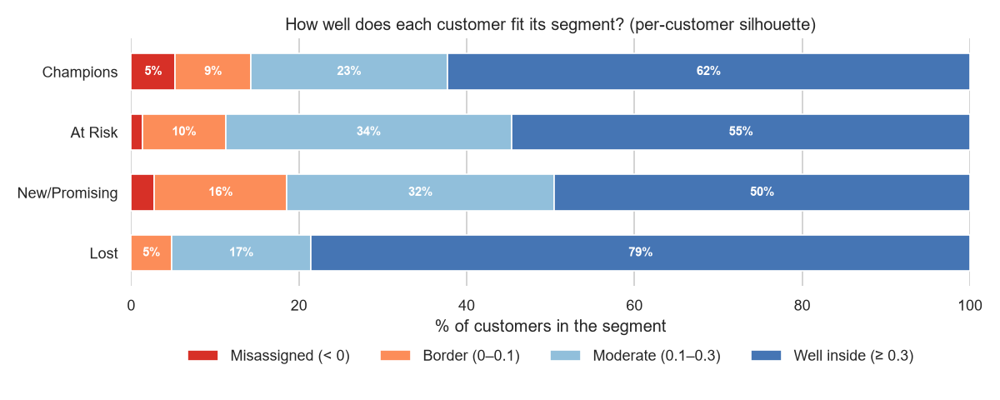

**Observation:** DBSCAN and the k=6 solution both isolate a small group of **key accounts** inside Champions
(~4–7% of customers, ~40–50% of revenue). It is reported as a finding; the final model keeps four segments.

---

## Limitations & next steps

**Limitations**
- 22.8% of transactions have no Customer ID and are excluded.
- Static snapshot at a single reference date (2011-12-10).
- Retail and wholesale customers are mixed in the same segmentation.
- The log1p transform creates artificially sparse regions that DBSCAN flags as noise.

**Next steps**
- Temporal validation: recompute segments at different dates and track transitions (e.g., Champions → At Risk).
- Add features: product categories, tenure, country, returns rate.
- A/B test the recommended action for each segment.

---

## Repository structure

```
├── customersegmentation.ipynb   # Full analysis (EDA → RFM → models → validation → interpretation)
├── figures/                     # Charts exported by the notebook
├── requirements.txt
├── .gitignore
└── README.md
```

## How to run

1. Clone the repository and install the dependencies:
   ```bash
   pip install -r requirements.txt
   ```
2. Download `online_retail_II.xlsx` from [UCI](https://archive.ics.uci.edu/dataset/502/online+retail+ii)
   and place it in a `data/` folder at the project root.
3. Open `customersegmentation.ipynb` and run all cells. The first run converts the Excel file into a CSV cache (2–3 min).

## Tools

Python · pandas · NumPy · scikit-learn · SciPy · Matplotlib · Seaborn · Jupyter

---

**Author:** [Your Name] · [LinkedIn](https://www.linkedin.com/in/your-profile)
